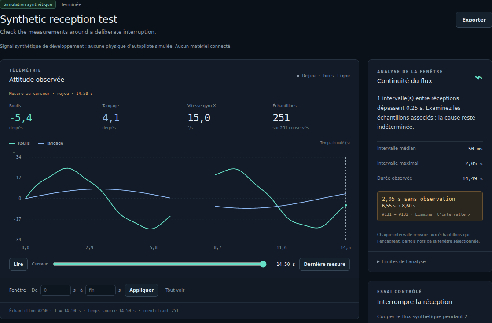

# ARGOS Studio

**Work in progress. V1 isn't ready yet.**

ARGOS Studio is a workspace I'm building for investigating drone data with an
AI agent. The idea is to keep the measurements, notes and analyses from a test
in one session, so I can come back to it and continue the investigation.

I'm starting with reception quality. Record a stream, find a gap and open the
measurements around it to understand what was received. The local analysis
tools already work; an optional agent can use those tools and keep a trace of
its work. Its behaviour with a live model still needs to be evaluated.



*The current prototype with synthetic data. The interface is in French; code and
documentation are in English. [Screenshot details](docs/media/README.md).*

[Try it locally](#run-locally) · [First session](#try-a-first-session) ·
[Usage and technical guide](docs/usage.md)

## What exists so far

- **Persistent sessions.** Save a stream with its objective, measurements, notes
  and events, then reopen it for replay or export it as JSON.
- **Reception investigations.** Find gaps, inspect the samples on either side
  and keep a report with the evidence and the questions it leaves open.
- **Synthetic comparisons.** Compare a normal capture with one containing a
  deliberate interruption. Both recordings and their comparison are retained.
- **An optional investigation agent.** Ask about a selected session or time
  window, inspect its tool calls and keep the answer alongside the data.

Data can come from the built-in synthetic source, passive local MAVLink/SITL
reception or an existing ARGOS recording through an optional import adapter.
The synthetic source generates mathematical signals; it is not a flight simulator.

The automatic **À examiner** queue and reception reports run locally without
an AI model. They identify gaps in the received data, not their physical cause.
A gap alone doesn't tell us how many packets were lost or why reception stopped.

## Still in progress

The agent is disabled by default. Its tests use scripted responses and HTTP
simulations; they do not establish how well a real model investigates a problem.
The current adapter requires an explicitly configured provider, model and API
key. Session excerpts used by the agent are sent to that provider when a
request is submitted. The local workflow works without it.

Acquisition is limited to one source at a time, with a three-minute session
limit. Live reception currently supports local UDP for simulation. Serial/USB
inputs, hardware commands and integrated UAV Debugger or Meridian modules are
not implemented. There is no hardware or flight validation for this prototype.

## Run locally

Use **Python 3.12+ on Linux or macOS**. Native Windows execution is not supported.

```sh
git clone https://github.com/victormonnot/argos-studio.git
cd argos-studio
python3 -m venv .venv
.venv/bin/python -m pip install -r requirements-dev.lock
.venv/bin/argos-studio
```

Open [http://127.0.0.1:8765](http://127.0.0.1:8765). No frontend build, API key,
simulator installation or drone is needed to try the synthetic workflow.

Data stays in `.data/` by default. Use `--data-dir /path/to/data` to choose
another directory or `--port 8766` to use another port. Each data directory
belongs to one server process. The [guide](docs/usage.md#run-locally) also
covers access over SSH.

## Try a first session

1. Choose **Simulation synthétique**, enter a name and objective, then click
   **Démarrer**. Let a few seconds of measurements arrive.
2. Add a note with **Marquer**, then click **Provoquer une interruption de 2 s**.
3. Wait for reception to resume, then click **Arrêter la session**.
4. Open the gap in **Continuité du flux** and use **Investiguer cette fenêtre** to
   create a local report. Open its evidence to return to the exact measurements.
5. Reopen the session from the sidebar or export it. The measurements, notes
   and saved reports remain available after restarting Studio.

The deliberate two-second pause and the measured interval between samples
will differ slightly because sample timing also contributes to that interval.
See the [full walkthrough](docs/usage.md#inspect-a-first-experiment) for the
observation queue and comparison workflow.

## Technical details

Studio uses **Python, FastAPI and SQLite**, with plain JavaScript and CSS for
the interface. Acquisition, storage and analysis are separate from the optional
agent. The UI and agent use the same analysis tools.

| Guide | What it covers |
| --- | --- |
| [Observations](docs/usage.md#review-automatically-detected-observations) | Gap discovery, review and saved evidence. |
| [Investigations](docs/usage.md#investigate-reception) | Reports, measurement references and analysis limits. |
| [Synthetic comparisons](docs/usage.md#execute-a-synthetic-comparison) | The fixed comparison protocol and retained results. |
| [Optional agent](docs/usage.md#connect-an-investigation-agent) | Configuration, tool access, traces and data sent to the provider. |
| [Local MAVLink reception](docs/usage.md#receive-a-local-mavlinksitl-stream) | Supported transport, source selection and raw captures. |
| [ARGOS import](docs/usage.md#import-an-argos-recording) | Native recording validation and provenance. |
| [Storage and limits](docs/usage.md#data-and-limits) | Retention, bounds and backup. |
| [Implementation and API](docs/usage.md#implementation-and-api) | Components and endpoints. |
| [Development checks](docs/usage.md#verify-changes) | Python and browser tests, with optional integration checks. |
